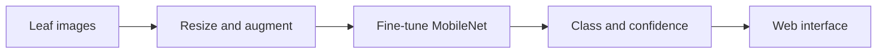

# 🌿 Plant AI — Plant Leaf Disease Detection

A computer vision project exploring how deep learning and an accessible web interface can help identify diseases from plant leaf images.

**Indus University · January–May 2024 · Team project**

[View the project poster](https://drive.google.com/file/d/12GmePs4CDrSnDd_jplYyfaf7TMNDqP5-/view)

## The challenge

Plant diseases can be difficult and time-consuming to identify by visual inspection. Plant AI explores image classification as a way to help users screen leaf images and receive an interpretable prediction.

## Approach

The project poster describes a transfer-learning workflow using a pretrained **MobileNet** convolutional neural network, fine-tuned on images of healthy and diseased leaves. A web interface lets users submit a leaf image and view predicted classes and confidence scores.

The project summary describes apple, tomato and potato leaves, including early and late blight. The poster lists **Python, TensorFlow, React, HTML and CSS** among the technologies.

## Reported result

The project summary reports **97% detection accuracy for early and late blight**. The poster does not specify the dataset, test split, sample size, or evaluation procedure behind this figure, so it should be read as a reported project result rather than an independently reproducible benchmark. Model confidence is not the same as certainty or field performance.

## Project materials

- [Project poster](https://drive.google.com/file/d/12GmePs4CDrSnDd_jplYyfaf7TMNDqP5-/view) — methodology, architecture, interface screenshots and team credits.
- This repository currently documents the project; the source code, trained model and dataset have not been added.

## Team and acknowledgments

**Hiral Choksi, Dharmik Mule and Vikash Maheshwari.** The poster also credits external guide Jignesh Gohil of Atharv Technolabs and internal guide Professor Sejal Thakkar of Indus University.

## Limitations and next steps

- Document the dataset source, class distribution and train/validation/test split.
- Add evaluation results such as a confusion matrix and per-class precision and recall when available.
- Test performance on real-world images with varied lighting, backgrounds and plant conditions.
- Predictions are intended to support further assessment and should not replace expert agricultural advice.
